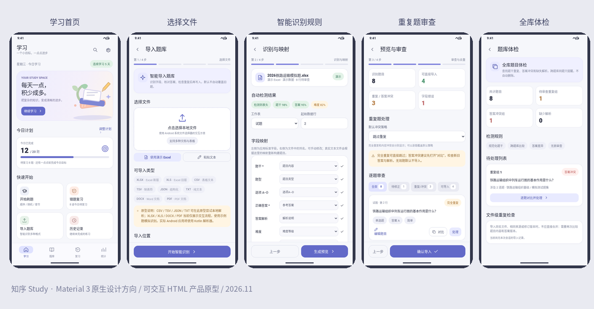

# 知序 Study｜Android 原生智能刷题应用 · 产品文档全书

**版本：V1.0 开发基线草案｜编制：2026-11-04**

> 文档用于产品与研发交接，设计完成不代表应用已实现。



## 文档结构

- 00_阅读指南_决策摘要

- 01_产品需求PRD

- 02_信息架构与逐页规格

- 03_视觉设计系统design

- 04_智能导入与规则引擎

- 05_答题考试复习与统计

- 06_数据模型与备份协议

- 07_技术架构与实现约束

- 08_测试矩阵与验收标准

- 09_迭代计划与开发任务

- 10_资料来源与原型对照

- 11_待决策事项与风险清单


---

# 知序 Study · 产品文档阅读指南与决策摘要

> **文档版本**：V1.0（开发基线草案）｜**日期**：2026-11-04｜**项目性质**：个人优先、离线优先的 Android 原生智能刷题应用。
> **状态定义**：已定＝产品已明确；待验证＝需用真实文件/设备验证；未来＝非首版交付。文档描述的是**产品规范与验收标准**，不代表 Kotlin 应用已经开发完成。

## 1. 一句话定义

**知序 Study** 是一个用 Kotlin + Jetpack Compose + Material 3 构建的 Android 本地刷题工具，以「可靠导入各种题库 → 清洗与审查 → 专注练习/考试 → 错题复习 → 学习统计」为核心闭环。界面采用 Material You 动态配色和少量柔和矢量插画，工作数据默认只保存在设备上。

## 2. 文档目录及建议阅读顺序

| 文档 | 读者 | 目的 |
|---|---|---|
| 01_产品需求PRD | 产品、研发、测试 | 定义用户、边界、优先级、功能编号和验收口径 |
| 02_信息架构与逐页规格 | UI、Android | 21 页导航、每页布局、行为、异常及状态 |
| 03_视觉设计系统design.md | 设计、Android | Material 3 颜色、排版、插画、动效、组件与无障碍 |
| 04_智能导入与规则引擎 | 数据、Android、测试 | 格式适配、规则库、识别、审查、去重、溯源、回滚 |
| 05_答题考试复习与统计 | 业务、测试 | 题型、判分、会话、复习算法、统计口径 |
| 06_数据模型与备份协议 | Android、测试 | 本地 Room 实体、索引、数据版本、备份导出、迁移 |
| 07_技术架构与实现约束 | Android | 模块划分、状态流、后台任务、安全与性能 |
| 08_测试矩阵与验收标准 | QA、产品、研发 | 真实文件、场景、异常、性能、可靠性和上线门禁 |
| 09_迭代计划与开发任务 | 产品、研发 | 阶段安排、依赖、产出物和每阶段退出条件 |
| 10_资料来源与原型对照 | 全体 | 官方规范、开源参考、现有 HTML 原型的真实性边界 |
| 11_待决策事项与风险清单 | 全体 | 未定项、风险级别、锁定条件与变更策略 |

配套目录 `samples/` 放置 JSON 题库示例、CSV 测试样本及规则预设示例；`reference/` 保留现有 HTML 原型与界面预览。

## 3. 已定事项

1. **技术**：Kotlin；Jetpack Compose；Material 3；Room；DataStore；Coroutines/Flow；Android 系统文件选择器。Android 系统版本下限暂设 **minSdk 26（Android 8）候选值**，须在构建后依据依赖和设备测试确认；动态取色仅在 Android 12+ 开启。
2. **页面**：共 21 个导航目的地。手机底部 4 个一级入口：学习、题库、复习、统计；其余页面在二级导航。宽屏使用 Navigation Rail/列表—详情双栏。不设手机端固定侧边栏。
3. **视觉**：参考用户提供的 Today 植物插画界面，但**不照搬界面**；采用柔和低饱和、开阔留白、细节插画。题目、选项、导入审查是高信息密度区域，不堆装饰。
4. **核心格式**：首版 XLSX、CSV/TSV、JSON、TXT；老 XLS、DOCX、PDF/OCR 依赖专项验证后排入后续迭代。复杂图片/公式/合并单元格不允许无提示地丢失内容。
5. **自动化原则**：规则优先、人工可核对、AI 可选。**识别不确定不能假装确定**。任何导入必须经过预览与验证，再落库。
6. **隐私**：无需账户、核心功能离线可用、默认不上传。AI 仅在用户显式授权时连接外部服务。
7. **数据安全**：学习记录和题目主体分离；版本追溯；导入批次日志；重复和冲突不静默删除；提供完整备份与恢复。

## 4. 首个交付范围（V1）

- 21 个页面的生产级 UI 骨架与核心数据状态；四个主导航与流程路由。
- 正式解析 XLSX、CSV/TSV、JSON、TXT（Excel 流式处理能力需以真实文件测试通过为前提）。
- 单选、多选、判断、不定项选择；练习、模拟考试、收藏、错题、历史与统计。
- 字段映射、保存预设、规则清洗、逐题审查、批次提交、基础跨库去重与题库体检。
- JSON 题库导出与应用完整备份/恢复；暗色/动态色/无障碍。

**非 V1 必达**：AI 解释与自动修复、PDF OCR、云同步、用户系统、在线题库市场、共享协作、自动推断所有复杂 Word 版式、填空/简答正式判分。UI 可预留入口，但不能呈现无法执行的假按钮。

## 5. 关键验收红线

- 错误答案（如 A、Z，只有 A–D 选项）默认不得作为可答题目无警告导入。
- 取消/失败/中断导入不得产生半套脏数据；批次必须可追溯。
- 跨题库重复、题干相同答案冲突不得由系统静默删除。
- 导入同一文件两次、题目编辑、重新导入更新不得破坏已有作答记录。
- 无网时可以读题、答题、保存进度、复习和导出本地数据。
- 所有 21 页必须有真实可达的路由，空态、载入态、错误态可见且可恢复。

## 6. 现有资产与产品真实性

此前生成的 HTML 原型是**交互验证模型**：有 21 个页面、简单 CSV/TSV/JSON/TXT 的演示解析和导入流程；它**不是 Kotlin/Compose APK**，并不真正解析 XLSX/DOCX/PDF，部分统计为演示值。任何实现验收均以本套文档 + 真实 Android 测试为准。

## 7. 对后续提供 Excel 示例的处理

用户发送实例后：保存原始样本只用于本项目测试；先创建匿名化、可复现测试夹具；记录表头、合并单元格、Sheet、选项布局、答案编码、解析与特殊字符；补充映射预设和金标题目，再更新 `04` 和 `08` 文档。**目前不虚构示例文件内容。**


---

# 01 · 产品需求文档 PRD

**项目**：知序 Study ｜ **版本**：V1.0 开发基线草案 ｜ **平台**：Android 原生（Kotlin/Compose）

## 1. 愿景、定位与用户收益

普通刷题软件常要求用户遵守单一模板，难以处理多 Sheet、错乱的答案列、重复题及题目修订。知序的竞争力应放在 **「有来源的题库数据 + 可解释的导入规则 + 可恢复的学习档案」**，不以海量免费在线题库作为卖点。

目标用户：①拥有自制 Excel/CSV/文本题库的考生；②复习专业课程和招聘笔试的学生；③需要整理多个来源题目的教师/备考者；④无网络环境下学习的用户。核心使用场景：初次导入、持续追加题目、重复题审查、零碎时间顺刷、正式模拟考试、错题复盘、换机恢复。

核心指标（验收目标而非已实现事实）：在标准测试集上字段识别准确、没有静默数据丢失；常规题库按原顺序可连续刷题；断点恢复正确；20 个不同来源的异常文件能给出可行动的诊断。不要把自动识别率作为唯一指标，**可追溯和可修复**同等重要。

## 2. 用户故事

- US-01 我拿到一份 `.xlsx`，希望直接选中文件，看见识别结果、映射和异常，而不是先手动改成模板。
- US-02 我希望将多个题库归入同一课程，仍能追溯每道题来自哪个文件、Sheet、行号。
- US-03 我想对答案 A、Z、选项缺失、解析与答案矛盾的题目逐个检查并修正。
- US-04 我想重复导入更新版，系统提醒重复文件、相同题干与答案冲突，而不是清空历史记录。
- US-05 我希望随手开始 20 题随机练习，关闭程序后还能恢复。
- US-06 我希望多选题必须确认提交，模拟考试交卷之前不暴露正确答案。
- US-07 我希望当天待复习的错题自动出现，可以关闭通知、关闭 AI。
- US-08 我希望切换设备时完整带走题目、图片、收藏、错题、学习记录及设置。
- US-09 我希望所有页面遵循手机系统动态配色，屏幕阅读器也能使用。

## 3. 功能范围与优先级

优先级：P0＝首版不可缺；P1＝首版增强、可排在 P0 之后；P2＝后续版本。

| ID | 子系统 | 需求概要 | 优先级 | 验收关注点 |
|---|---|---|---|---|
| FR-001 | 首页 | 今日学习、继续学习、最近题库、空态导入引导 | P0 | 入口可达，无数据不空白 |
| FR-002 | 题库 | 新建/重命名/归类/删除/批量/搜索/筛选 | P0 | 删除二次确认、恢复策略 |
| FR-003 | 题目 | 新建/编辑/复制/标签/难度/解析/版本 | P0 | 选择题答案引用正确 |
| FR-004 | 选择文件 | SAF 选择、文件嗅探、目标库设置 | P0 | 权限不超范围 |
| FR-005 | 结构分析 | Sheet/标题行/列识别、候选字段 | P0 | 能手工覆写识别 |
| FR-006 | 自定义规则 | 清洗和映射配置、预设保存与测试 | P0 | 规则顺序可见、可撤销 |
| FR-007 | 预览审查 | 逐题原文/标准化对照、编辑/跳过/纠错 | P0 | 修正后重新校验 |
| FR-008 | 重复审查 | 同批/同库/跨库/答案冲突/文件重复 | P0 | 默认保守不删除 |
| FR-009 | 导入提交 | 单批事务、取消、进度、报告、批次历史 | P0 | 失败不写半成品 |
| FR-010 | 顺序/随机/专项 | 按题库、章节、题型、难度组卷 | P0 | 抽题集合稳定且可复现 |
| FR-011 | 答题 | 单选、多选、判断、不定项、解析/收藏/标记 | P0 | 交卷后锁定答案 |
| FR-012 | 模拟考试 | 计时、延迟解析、交卷、断点恢复 | P0 | 时间到自动交卷 |
| FR-013 | 历史与复盘 | 会话记录、答案快照、错题重练 | P0 | 编辑后旧记录仍可解读 |
| FR-014 | 复习 | 错题、收藏、疑难、每日任务、复习计划 | P0 | 不因一次正确就永久清错 |
| FR-015 | 统计 | 练习量、准确率、耗时、章节薄弱点 | P0 | 分母定义明确 |
| FR-016 | 导出备份 | JSON/应用备份/恢复、版本检查 | P0 | 原子恢复/预检与回滚 |
| FR-017 | 主题无障碍 | 动态色、深浅色、字体/触控/TalkBack | P0 | 48dp 热区 |
| FR-018 | 大题库性能 | 分批读入、分页列表、FTS 搜索 | P0 | 5 万题压力测试目标 |
| FR-019 | AI | 可配置服务商、在线答疑、导入辅助 | P2 | 必须主动发送且可取消 |
| FR-020 | 扩展格式 | XLS、DOCX、PDF/OCR | P2 | 先建立真实文件兼容矩阵 |
| FR-021 | 非选择题 | 填空、简答、自评 | P2 | 不误导为自动客观判分 |
| FR-022 | 通知 | 定时复习提醒、系统通知权限 | P1 | 用户开启后才请求权限 |
| FR-023 | 题库体检 | 跨批次/跨库异常聚类、人工核对状态 | P0 | 审查不等于自动清理 |

## 4. 端到端主要流程

### A · 初次导入

首页/题库/FAB → 文件选取 → 格式识别 → 选择工作表/布局 → 调整映射和规则 → 生成候选题 → 校验并分类 → 去重冲突决策 → 逐题修正 → 最终确认 → 批次写入 → 导入报告 → 题库详情。

用户可以中途返回上一步；改变标题行或字段映射需重新生成候选题，**保留已有人工修改前必须提示并提供草稿恢复**。不合法答案保留为“待处理候选题”，不允许混入可考试题集。

### B · 练习

首页/题库详情/复习中心 → 练习配置 → 生成题目快照并建立会话 → 作答与保存 → 提交单题/统一交卷 → 成绩/解析 → 错题与复习计划更新 → 历史可追溯。

### C · 更新题库

选择新版文件 → 比对同一批次或文件 SHA-256 → 显示增量/删除候选/变更与冲突 → 根据题目稳定 ID/来源关联决定版本 → 保存修订日志 → 不破坏旧的尝试记录。

### D · 备份/恢复

设置 → 数据管理 → 选择导出范围及加密选项 → SAF 选择存储位置 → 校验打包 → 保存文件；恢复时先校验包版本/完整性/空间/冲突策略，成功后切换新数据集，失败回滚旧数据。

## 5. 信息模型与交互理念

- **题库（QuestionBank）**：资料容器；可含章节/知识点/标签。
- **题目（Question）**：稳定身份 + 当前版本；选项答案不使用逗号拼接字符串作为唯一存储方式。
- **题目修订（QuestionRevision）**：每次修改保留版本与变更来源。
- **导入批次（ImportBatch）**：记录文件、配置、校验报告、事务结果；可执行批次级撤销（受引用约束）。
- **练习会话（StudySession）**：选题与顺序快照、已选选项、开始/结束、模式。
- **作答（Attempt）**：同一道题多次作答和历史统计，不因重新练习覆盖。
- **掌握度（MasteryState）**：是算法可重建的派生状态，不代替原始作答记录。

## 6. 状态、空态、异常和权限

所有页面定义 `Loading / Content / Empty / Error / Offline（必要时）`。异步业务具有 `Idle / Running(progress) / Paused? / Cancelled / Failed / Completed`。每个错误给出“原因 + 影响 + 下一步操作”，不使用仅有“失败”的 Toast。仅使用系统文件选择器授权，不申请全盘读写权限。通知、联网 AI 都是后续独立授权。

## 7. 非功能性需求

**可靠性**：异常导入不污染数据库；应用被系统回收后恢复最后提交的学习状态；备份导入有完整性校验。**性能**：5 万题/含长文本的数据集完成列表分页、搜索和切题压力测试；对大文件设安全限制和进度反馈，阈值需通过低端设备测试确定。**可访问性**：缩放字体、TalkBack、明确的选中状态、最低 48dp 热区；正确/错误不只依赖颜色。**隐私**：离线优先、密钥不进日志；用户明确同意后才发送外部请求。**可维护性**：解析器与数据库解耦，规则配置版本化，所有算法有金标测试。

## 8. 不做什么

V1 不内建在线题库商城、不做用户社区/社交、不用 AI 自动重写标准答案、不读取用户未授权的目录、不将 HTML 原型包装成假原生应用、不用云端才能打开本地题目。

## 9. 关键验收条款

P0 条目必须全部具备可操作 UI、可持久化逻辑和测试覆盖。所有导入页面的按钮必须有功能，若延期则隐藏而不是保留无法执行的控件。见 `08_测试矩阵与验收标准.md`。


---

# 02 · 信息架构、导航图与 21 页逐页 UI 规格

## 1. 导航总图

```text
应用（单 Activity / Compose）
├─ Tab「学习」01
│  ├─ 练习配置 12 → 答题 13 → 练习结果 14 → 复盘 15
│  ├─ 历史记录 16 → 结果/复盘
│  └─ 设置 18 → 数据管理 19 / AI 服务 21
├─ Tab「题库」02
│  ├─ 题库详情 05 → 题目列表 06 → 题目编辑 07
│  │             ├→ 练习配置 12
│  │             └→ 题库体检 20
│  └─ 导入文件 08 → 识别/映射 09 → 审查 10 → 结果 11 → 题库详情
├─ Tab「复习」03 → 复习计划 17 / 练习配置 12
└─ Tab「统计」04 → 历史记录 16 → 结果/复盘
```

导航原则：手机 4 个一级 Tab；二级页面顶部返回，不重复提供多套菜单。紧凑窗口主导航为 `NavigationBar`；较宽窗口用 `NavigationRail`；题目列表和详情用 List–Detail。保存每个 Tab 的回退栈，进入答题是独立流程，避免底栏误触离场。

## 2. 全局外壳（App Shell）

- **状态栏/系统栏**：edge-to-edge，按主题适配图标颜色；内容为系统栏留出 Insets。
- **一级页顶部**：页面名（大标题可收缩）、右侧仅保留有意义动作。一级页底部为 NavigationBar，某些全屏学习状态隐藏底栏。
- **二级页顶部**：导航返回、标题、1–2 个主操作、`更多` 菜单；破坏性操作与普通操作视觉分开。
- **固定操作栏**：导入预览/答题页使用底部安全区内的 `Scaffold` bottomBar；长内容独立滚动。
- **弹层选择**：少量选择项使用 BottomSheet；复杂修订使用整页；删除/丢弃/覆盖用 Dialog；非阻断信息用 Snackbar。
- **统一页面状态**：加载骨架、空态插画 + 单个 CTA、错误诊断 + 重试、成功确认；禁用态必须解释原因。

## 3. 每页详细交互规格

### P01 · 学习首页（一级 Tab）
**入口**：应用启动默认页，底部「学习」。**布局**：上方 Today 式大标题「今天，继续前进」与圆角小插画；今日待完成提示；「继续上次练习」主卡；四宫格「顺序练习/随机练习/错题复习/导入题库」；最近题库横向列表；本周小型进度模块。**顶部操作**：搜索（全库题目）、设置图标。**行为**：「继续」恢复上次未完成 session；「导入」直达 P08；首页卡片进入 P12 或 P05。**空态**：没有题库显示插画、选文件主按钮、体验示例的次按钮（样例明确标识）。**错误**：最近题库损坏时可诊断且不阻断其他库。

### P02 · 题库首页（一级 Tab）
**布局**：标题「题库」；搜索 TextField；排序/分类 Chips；分组/题库列表（题量、已学、进度、更新时间）；右下角 Extended FAB「导入」。**顶部操作**：管理模式/新建题库。**长按**：进入批量选中，允许移动分组、导出、归档、删除。**入口**：点题库进 P05；FAB 主动作 P08；新建进入名称/颜色/分组创建 Sheet。**空态**：导入或新建。**异常**：重名允许但提示；删除时告知题目是否共用、历史如何保留。

### P03 · 复习中心（一级 Tab）
**布局**：今日复习计划进度与轻量纸张插画；四个分类 Chip「待复习/错题/收藏/疑难」；每类列出题目数、所属题库和建议顺序；一键复习主按钮。**操作**：进入 P17 调整计划；进入 P12 自定义范围；单题点击可预览及练习。**空态**：没有错题时展示积极但不夸大的说明；不可混淆「无错误记录」与「全部掌握」。**异常**：算法调度为空但仍可进入历史错题。

### P04 · 学习统计（一级 Tab）
**布局**：顶部时间段 segmented control「7 天/30 天/全部」；指标卡「作答题次、首次正确率、累计准确率、总用时」；趋势图；按章节/题库的薄弱点；最近历史。**操作**：过滤题库、点击弱项跳 P12、历史跳 P16。**定义**：首次正确率按首答题数统计；累计准确率按所有有效提交次数统计；详见 05。**空态**：先练题再展示趋势。**无障碍**：图表给出文字表述。

### P05 · 题库详情
**入口**：P02 题库卡、P11 导入完成。**布局**：题库名称和封面、小进度；「开始练习」主按钮；题量/章节/错题数；章节列表；管理工具块。**操作**：题目列表 P06、追加导入 P08（默认选中当前库）、体检 P20、题库编辑、导出。**异常**：被归档仍允许导出；空库允许添加题目或导入。

### P06 · 题目列表
**布局**：顶部搜索、题型/难度/章节/状态筛选；LazyColumn 卡片：题型、题干 2 行、来源、难度、编辑状态；列表/多选模式。**操作**：点击打开题目详情预览 BottomSheet；编辑 P07；复制/移动/批量删除；顶部新增；底部可显示「练这些题」。**校验**：待完善题与正式可答题以图标+文字区分。**异常**：搜索无结果提供清空条件。

### P07 · 题目编辑
**布局**：题型下拉；题干多行输入/插图插入；动态选项列表；答案选择区域；解析富文本/基础 Markdown 字段；难度、章节、标签、来源；保存/取消底栏。**行为**：添加/删选项会核验答案引用；离开有未保存更改弹确认；保存创建 revision。**验证**：至少 2 个有效选项（客观选择题）；答案非空且全部指向有效选项；不允许重复选项 ID。**高级**：人工标记「待完善」可保存草稿，但不能加入考试。

### P08 · 文件选择（导入 1/4）
**入口**：首页、题库 FAB、题库详情追加导入。**布局**：简洁大卡「选择文件」使用系统 SAF；支持格式徽标；最近导入文件（仅显示最近记录，重开可能需重新授权）；目标库下拉；导入方式说明。**核心动作**：选择单文件或批量文件（V1 建议单文件/单批次，可重复添加队列）；点击「开始识别」进入 P09。**异常**：未选文件禁用；文件与后缀不符提示；空文件、损坏文件、超限需明确报错。**文案**：不要声称 XLS/DOCX/PDF 在 V1 已正式可用。

### P09 · 结构识别与字段映射（导入 2/4）
**布局**：文件基本信息/解析警告；Sheet 分段切换与预览表格；标题行定位；布局模式「每行一题/题目多行/题干选项合一」；标准字段左列与检测到的原始列右列；置信度与理由；「预处理规则」可展开分组；规则预设下拉及「保存为预设」；底部「生成预览」。**行为**：任何映射变更都重新运行相关规则并更新样本预览；规则有启用开关、排序、编辑、测试示例；同一原始列重复映射给不兼容字段时提醒冲突；允许暂时保留未映射的非核心字段。**异常**：找不到题干列必须人工指定；存在双 Sheet 关联时需要选择主键/题号匹配方式。

### P10 · 导入预览与审查（导入 3/4）
**布局**：顶部四个统计 Chip「可导入/待复核/冲突/无效」；可筛选表格或逐题列表；题目卡含原行号、源字段、规范化结果、校验错误；重复比对展开左右内容；全局重复策略区域与每题覆盖选择；底栏「确认导入」。**逐题**：点卡进入编辑 Sheet/整页，展示原值与新值对照、预期答案、章节，保存即重校验。**阻断**：答案指向不存在的选项、无法识别题干、答题型不完整且未标记草稿时，不能作为可答题提交；可选择跳过或保存草稿。**冲突默认**：跳过并待人工决定，绝不默默替换。**离开**：未完成草稿保存并提示。

### P11 · 导入结果（导入 4/4）
**布局**：轻量完成插画；明确显示「新增 N / 更新 N / 跳过 N / 冲突待处理 N / 无效 N」；批次时间、原文件、处理耗时与日志；「打开题库」主按钮；「查看报告」「继续导入」。**注意**：统计分组互斥且可追溯；无效项只进入审查草稿时应单独标注，不计可答题数。**失败**：错误报告说明是否整个事务回滚；提供重试。

### P12 · 练习配置
**布局**：题库/章节/标签选择；模式 Tab「顺序/随机/专项/考试」；题型、难度、题数、排序、时间限制、显示解析策略；预计可用题数提示；「开始」固定底栏。**行为**：配置保存为最近使用；范围变更实时刷新可用题数；如不足量允许减量或取消，但不能悄然补用其他题库。**复习入口**：预填错题集合。

### P13 · 答题页
**布局**：简洁顶部栏（退出、题号、收藏、答题卡）；线形进度；题型/难度微标签；题干大段正文；可选插图；大面积选项 Card；底部固定「上一题/提交或查看解析/下一题」。**单选**：选一项替换；**多选**：多项勾选，提交后锁定；**判断**：正确/错误；**不定项**：依题型允许一个或多个，统一提交。**练习模式**：提交后展示标准答案、已选答案、判分及解析；**考试模式**：禁止提前泄露标准答案，交卷后统一展示。**状态**：未作答、已选未提交、正确、错误、已标记、已锁定。**退出**：自动保存并提供继续；返回手势与系统返回一致。**长内容**：题干选项区滚动，不盖住底栏。

### P14 · 练习结果
**布局**：数字化结果 + 少量纸张插画；分数/正确率/错题/未答/耗时；题型明细；建议回看。**动作**：「查看复盘」P15、「错题再练」P12、「回首页」。**考试**：时间到自动交卷亦给出明确标记。**定义**：未答与错误分开统计。

### P15 · 答题复盘
**布局**：题号筛选「全部/错误/未答/正确」；每题显示用户所选、正确答案、解析及首次作答时间；可收藏、转错题；错误选项解释（如果存在）。**行为**：复盘不会改变历史成绩；如果订正题目，显示「此结果使用题目版本 vX」。

### P16 · 历史记录
**布局**：按日期分组的 Session 卡（模式、题库、耗时、得分、完成状态）；筛选类型、日期。**操作**：未完成继续作答；已完成查看 P14/P15；删除历史记录需二次确认，不删除题目本身。

### P17 · 复习计划
**布局**：每日目标选择器；调度方式解释；待复习量预测；提醒开关/时间选择；上一次复习和下一次复习说明。**行为**：改变目标数量不直接篡改历史；通知关闭默认不请求权限；时区变化和跨天按设备本地日期处理。

### P18 · 设置
**布局**：外观（跟随系统/浅色/深色、动态色、插画开关）；练习偏好（单选即判/提交判、多选严格判分、即时解析、振动、滑动切题）；数据入口；AI 服务入口；关于/开源许可。**控件**：Material Switch/Radio/Button；变化应即刻持久化并说明范围。

### P19 · 数据管理
**布局**：数据库摘要（题库、题量、练习记录、媒体占用）；「导出题库 JSON」「创建完整备份」「从备份恢复」「查看导入批次」「清理临时文件」。**行为**：导出使用 SAF；恢复预先做版本/哈希/可用空间校验；清空操作采用二次确认并提示备份。**异常**：写入失败不显示完成；取消时不删除现有数据。

### P20 · 题库体检
**布局**：全库分析摘要（完全重复、相似、答案冲突、待完善）；分类过滤；可展开的重复组和原题-候选对比；每组「标记已核对/保留两版/建议合并/查看来源」；开始扫描入口。**默认**：扫描为只读，不自动修改题目；建议合并需单独确认并保留可追溯关系。**冲突**：题干相同但答案不同用显著文字提示；不能因跨库重复而误删作答记录。

### P21 · AI 服务（可选增强，非 V1 必交）
**布局**：启用提示与隐私说明；服务商类型、API 协议、Base URL、模型名称、密钥输入（默认遮蔽）、联网测试、能力开关「解析/导入辅助」。**行为**：选择服务商只更新本地配置；发送题干前确认内容范围；保存密钥使用安全存储方案；服务不可用时基础功能照常工作。**V1 交付策略**：如果实现未完成，设置中隐藏此页入口或标注独立规划页，不能出现装饰性测试按钮。

## 4. 宽屏、横屏与键盘交互

- **手机小窗**：单列，主导航底部；全屏答题时隐藏主导航，避免意外离场。
- **平板/折叠屏展开**：导航栏移左，题库列表（约 30–40%）与题目详情（其余宽度）并列；导入 P09 可左右显示源表与映射，P10 可三栏「异常列表—原文—修正」。
- **实体键盘**：搜索 Enter、Esc 返回、Tab 顺序、题目 A/B/C/D 可选作为可关闭的快捷键；Space 不得与页面滚动冲突。
- **系统字体最大化**：标题可换行，操作栏不因超大字体使确认键被截断；一行四宫格必要时变成 2 列。

## 5. 页面级 DoD（Definition of Done）

每页需提供：① Compose Screen + Preview（亮/暗/空态），② ViewModel + UiState/Action，③ 路由及返回，④ TalkBack 语义，⑤ loading/empty/error，⑥持久化与用户反馈，⑦基本 UI 自动测试。参照 `08_测试矩阵与验收标准.md`。


---

# 03 · 知序 Study 视觉设计系统（design.md）

## 1. 视觉定位

- **设计系统**：Material 3 原生组件优先，适当引入 M3 Expressive 的布局、形状和动效；不做 iOS 仿制，也不把自定义 HTML 视觉直接硬套入 Android。
- **气质**：安静、可信、温暖、轻量。借鉴用户提供的植物照护截图中的“宽松留白、温和背景卡、散落一点插画、深浅色统一”；插画原创设计并与主题色角色配合。
- **内容优先级**：答题文本 > 选项状态 > 导入错误/答案冲突 > 操作按钮 > 说明 > 插画。
- **用图位置**：首页、空题库、复习引导、导入成功、练习完成；不在题目列表/审查表格每一行添加插图。

## 2. Design Tokens

| 设计项 | 推荐 Token | 规则 |
|---|---|---|
| 主色 | `MaterialTheme.colorScheme.primary` | Android 12+ 默认动态色，固定主题作备选 |
| 容器 | `surface`, `surfaceContainerLow`, `surfaceContainerHigh` | 用轻层级区分，避免阴影叠阴影 |
| 正文 | `onSurface` | 必须具有足够对比度 |
| 次级说明 | `onSurfaceVariant` | 不承载关键错误提示 |
| 成功 | `tertiary`/语义扩展 `success` | 文字与图形一起传达，不只靠色彩 |
| 错误 | `error`,`errorContainer` | 错误来源和修复操作必须可见 |
| 形状 | `Shapes.small/medium/large/extraLarge` | 卡片 12–20dp 视觉区间，实际使用 M3 Shape Token |
| 间距 | 4dp 基本网格、8dp 复用步长 | 页面左右 16–24dp（根据尺寸类别） |
| 触控 | ≥48×48dp | 小图标周围增加可点击区域 |
| 文字 | Material 3 Typography + 系统中文字体 | 题干 17–20sp；常规正文 14–16sp；极端字体缩放不截断 |

固定配色参考（**仅用于非动态色预览；不可直接给语义角色硬编码**）：`#F6F7FB` 背景，`#6269C8` 主色，`#E8E7FF` 次色容器，`#FFE8DE` 桃色辅助，`#E6F3EB` 薄荷辅助，`#24283B` 主文字。深色模式由完整 ColorScheme 导出，不把浅色简单反相。

## 3. 页面布局样式

### 首页

- 主标题可用 28–32sp；顶部留出充足空间，但在普通屏高 700dp 左右仍应看到「继续学习」主按钮。
- 欢迎插画为低对比书本/纸张/叶片/铅笔等原创矢量形状。插画框最多占首屏高度约 18–22%，不可妨碍学习。
- 今日目标卡与最近题库卡使用不同层级的 Surface Container，强调层级而非不同颜色数量。

### 答题

- 一道题一屏的心理单位，题干不会与顶部图标并列压缩；长题干纵向滚动。
- 选项选中背景使用 `secondaryContainer` 或 `primaryContainer`；正确/错误状态采用图标 + 文案 + 边框对照。
- 底部主按钮与系统导航安全区隔离；提交反馈可展开局部解析板，不弹出必须手动关闭的对话框。

### 结构映射与审查

- 数据密度高，少装饰。表格每个字段映射一行：**目标字段 → 来源字段 → 可信度及依据 → 测试结果**。
- 审查页用分层状态标记：已通过/待复核/冲突/不合格；状态靠图标、标签、文字说明三重表达。
- 支持“仅看问题”，不会因为智能识别信心低而自动用错误值替换。

## 4. 组件契约

| 产品组件 | 官方 Compose 实现参考 | 状态/禁忌 |
|---|---|---|
| 主按钮 | `Button` | 同页只突出 1 个主 CTA |
| 次按钮 | `OutlinedButton`, `FilledTonalButton` | 删除不得与导入同等视觉强调 |
| 卡片 | `Card`, `ListItem` | 列表避免每行多层嵌套卡 |
| 搜索 | `SearchBar` / `OutlinedTextField` | 有清空按钮；返回保留上次查询策略 |
| 标签筛选 | `FilterChip`, `AssistChip` | 选中状态有文字/对勾 |
| 选项 | `RadioButton` / `Checkbox` + 整行可点 | 正确处理多选与焦点 |
| 底部弹层 | `ModalBottomSheet` | 简单确认/筛选使用，复杂编辑整页 |
| 危险确认 | `AlertDialog` | 解释影响对象与历史处理 |
| 通知 | `SnackbarHost` | 不用 Toast 告知永久错误 |
| 进度 | `LinearProgressIndicator` | 确定进度用数值，不可确定用不定进度 |
| 插画 | `ImageVector` 或本地 Drawable | 装饰性图像 TalkBack 可忽略 |

## 5. 动效规范

- **原则**：交互反馈优先，低眩晕，不持续循环；尊重系统减少动画设置。
- 主导航：Android 默认页面转场；内容区域基于状态切换使用温和显隐（建议 150–250ms，属初始设计建议，实机验证后调节）。
- 选项：选中背景/边框短时过渡（不做弹跳）；错误校验提供清晰但不惊扰的动画。
- 导入：进度从“读取→识别→校验→审查→写入”逐段更新；不可使用假进度条承诺固定完成时间。
- 插画：可选择仅首帧静态、局部轻微变化；不用高成本持续动效。

## 6. 可访问性与极端情况

- TalkBack：题干先读题号、题型、题干；选项读“选项 A、文字、已选/未选”；提交后读“回答错误，正确答案为……”但考试中不泄露答案。
- 色觉差异：错误和正确有图标和文字；冲突不能仅用红框。
- 字体缩放：使用 `sp`，多行容器高度自适应；不把文字剪裁在固定尺寸卡片中。
- 触控目标：不小于 48dp；拖拽排序规则有替代按钮「上移/下移」。
- 横屏/平板：大标题收敛，列表-详情布局，内嵌弹层不跨越全屏过宽。
- RTL：必要时遵循系统布局方向；答案字母 A/B/C 不应倒置。

## 7. 设计资源策略

产品插画应使用原创 SVG/vector drawable，颜色来自主题 token 或受控调色板，提供亮暗变体；不将网上参考图片直接嵌入应用。图标使用统一的 Material Symbols 风格和一致描边；自定义 icon 先检查必要性。

## 8. 页面审美审查清单

统一字号级别、内外边距、点击热区、行高、圆角、菜单位置；所有按钮有明确行为；深/浅色与动态配色无失衡；图标居中；至少 3 种长文本场景；低端设备列表滚动；所有插画不抢占正文；检查系统手势条、安全区、键盘弹出/关闭后的布局。


---

# 04 · 智能导入、规则引擎、审查和重复题处理规范

**重要原则**：本文件描述正式 Android 原生实现；此前 HTML 原型对 XLSX/XLS/DOCX/PDF 只演示流程，**不等于已实现解析**。

## 1. 能力与支持级别

| 类型 | V1 范围 | 结构与限制 | 验收 |
|---|---|---|---|
| XLSX | P0 | OOXML ZIP；多 Sheet、行列、共享字符串、公式缓存值、合并单元格信息；图片/富文本依赖专项实现 | 无法处理的内容必须提示 |
| CSV/TSV | P0 | UTF-8/UTF-8 BOM、GB18030 等编码检测/选择；RFC 4180 风格引号转义；自定义分隔符 | 保留换行与引号 |
| JSON | P0 | 原生标准格式和可配置字段路径；schemaVersion；数组字段映射 | 错误 JSON 逐项定位 |
| TXT | P0 | 以题号、选项标记、答案/解析关键词和空行分块；行内选项 | 不可误把题干内容当答案 |
| XLS | P2 | 老版 BIFF 格式专用读取方案 | 真实文件验证后上线 |
| DOCX | P2 | 段落 + 表格 + 样式/标题层级 | 富文本与图片兼容专项 |
| PDF/OCR | P2 | 优先文本层；图像 PDF 才 OCR | OCR 不确定必须人工核对 |
| ZIP 备份 | P0 | 知序自有数据备份，不将任意 ZIP 当题库导入 | 版本、哈希和路径防护 |

## 2. 处理链路与生命周期

```text
Uri / MIME / 文件头
→ 受控文件流读取 / 格式嗅探
→ 格式专属 Parser (SourceCell/SourceBlock)
→ 页面布局分类 + 标题行候选排序
→ 字段映射 MappingProfile
→ 有序清洗规则 RulePipeline
→ 标准化 CandidateQuestion + Provenance
→ 静态校验 Validator + Diagnostic
→ 内容指纹 / 相似性检测 / 跨库扫描
→ 审查工作区 (人工编辑、跳过、覆盖、保留)
→ Dry-run 汇总 → 用户确认
→ 数据库事务提交 + Revision / ImportBatch
→ 报告 + 可恢复审查草稿
```

每一层输入输出结构必须可测试；Parser 不直接写 Room，规则引擎不直接操作 URI，UI 不直接解析 OOXML。解析错误应定位 `filename/sheet/row/column/rawSnippet/code/severity`。

## 3. 识别项目与字段标准

标准必需字段：`stem`（题干）、`type`（题型；未知需待复核）、`options[]`、`answers[]`；非必需：`explanation`、`difficulty`、`chapter`、`tags`、`knowledgePoints`、`source`、`images`、`externalId`、`score`。对于客观选择题，题干非空、选项至少 2 项、答案集合非空且指向有效 optionId 才能进入可作答状态。

### 表头同义词库（种子，不是封闭列表）

| 标准字段 | 例示名称 |
|---|---|
| stem | 题目、题干、问题、试题、内容、Question、题目内容 |
| type | 题型、试题类型、分类、Type |
| answer | 答案、正确答案、参考答案、Answer、Key |
| explanation | 解析、答案解析、解题思路、Explanation |
| difficulty | 难度、难易程度、等级、Difficulty |
| chapter | 章节、章节名称、知识模块、所属章节 |
| option[A-H] | A、选项A、A项、Option A 等 |
| knowledgePoints | 知识点、考点、标签 |

字段检测不仅看标题，还看内容画像：答案列单字母/字母组合比例、解析列平均文本长度、题型列词典命中率、章节列重复分布、选项列起始字母模式。不给出无凭据的统一识别准确率。

## 4. 表格形态策略

| LayoutId | 特征 | 处理 |
|---|---|---|
| L1_OneRowPerQuestion | 每行一题，选项分列 | 逐行映射 |
| L2_OneCellOptions | 题干/选项合并在一个单元格 | 按选项前缀拆分，保留原文 |
| L3_MultiRowQuestion | 一题数行，题号/空行/合并单元格分组 | 先做题块化再抽字段 |
| L4_AnswerSheet | 题目 Sheet 与答案 Sheet 分离 | 题号/外部 ID 关联，禁止盲用行号 |
| L5_MixedTypes | 单选、多选、判断混排 | 逐行判定类型与别名 |
| L6_QuestionAnswerSections | 先题目后答案集 | 双区域识别和键关联 |

Sheet 列表至少显示名称、行数/列数估计、首几行预览、检出字段及疑似数据区域。自动标题行在前 N 行打分，N 可配置；合并单元格需明示采用左上角值传播策略并可撤销。

## 5. 答案归一化

**标准答案表示**：optionId 的有序无关集合，例如 `['opt-a','opt-c']`；展示层才使用 A/C 字母。选项乱序不得改变正确答案引用。

| 原值 | 解释原则 |
|---|---|
| `A`、`a`、`Ａ` | 可统一成 A |
| `A,C,D`、`A；C；D`、`A、C、D` | 明确多项 |
| `ACD` | 只有当已有选项集合且规则允许连写时拆为 A/C/D |
| `①③` / `1,3` | 仅在有确定编号映射时转换 |
| `√/正确/对/True` | 题型为判断且词典匹配时对应「正确」 |
| `×/错误/错/False` | 题型为判断且词典匹配时对应「错误」 |
| `A、Z` | Z 未定义则 INVALID_ANSWER_REF；不可静默删除 Z |
| `A/B` | 可能是“或”也可能是分隔；依据题型与预设确定，低置信度复核 |

题型冲突：来源标注“单选”但规范化答案有两项，标记 `TYPE_ANSWER_CONFLICT`；不擅自改成多选。难度统一 1–5 可附原始文本；未知难度存 null，绝不编造。

## 6. 置信度与诊断

建议将字段匹配分数限定 0..1，来源包括标题匹配(0.35)、内容画像(0.35)、结构位置(0.20)、跨行一致性(0.10)等**初始权重示例，需用真实样本校准**。最终并非概率保证。界面只展示「高/中/低 + 依据」，后台保留原始分数和规则版本。

`HIGH >= 0.90` 可自动填映射；`MEDIUM 0.65–0.90` 建议并提示；`LOW < 0.65` 需手工确认；但只要 `ERROR`/`BLOCKING` 诊断存在，不管分数多高都不能直接进入正式题库。权重和阈值是可配置默认值，需在真实 Excel 样本建立基线后冻结。

### 错误码样例

| 编码 | 级别 | 文案及恢复动作 |
|---|---|---|
| FILE_EMPTY | Block | 文件为空：重新选择文件 |
| FILE_UNSUPPORTED | Block | 不支持的文件格式：查看支持列表 |
| FILE_ENCRYPTED | Block | 受密码保护工作簿：先解锁后导入 |
| HEADER_AMBIGUOUS | Warn | 检测到多个标题行：手动选择 |
| FIELD_STEM_MISSING | Block | 未识别题干：设置题干列 |
| OPTIONS_TOO_FEW | Error | 有效选项不足 2 个：补齐或跳过 |
| INVALID_ANSWER_REF | Error | 答案引用不存在的选项：编辑答案 |
| TYPE_ANSWER_CONFLICT | Error | 单选题对应多个答案：人工核对 |
| ANSWER_MISSING | Error | 答案为空：作为草稿/跳过 |
| DUPLICATE_EXACT | Info | 发现完全重复：默认跳过 |
| DUPLICATE_CONFLICT | Warn | 同题答案有差异：查看对比 |
| FORMULA_NOT_CACHED | Warn | 公式没有可用缓存值：该字段需人工检查 |
| RESOURCE_TOO_LARGE | Block | 解压/行数/媒体超限：按提示分批处理 |

严重程度区别：`Block` 整个文件或核心映射无法继续；`Error` 单条不能成为可答题；`Warn` 可人工确认；`Info` 提示信息。

## 7. 自定义规则编辑器（P09）

规则实体包括：`id、name、scope、stage、priority、enabled、matcher、transform、condition、testCases、version、createdAt`。规则分为：

1. 输入归一化：全半角标准化、Unicode 空白、CRLF、不可见字符。
2. 题号移除：仅匹配行首 `1.`、`1、`、`(1)` 等，保留原值。
3. 字段提取：正则/关键字/列映射，从 `【答案】`、`答案:` 等抽取。
4. 选项拆分：A–H 标记，避免误判题干英语缩写。
5. 答案拆分：按分隔符/连写/数字索引。
6. 难度映射：困难、难、易、1–5、星级及空值。
7. 章节提取：Sheet 名、标题行、列值等。
8. 内容清洗：HTML 标签（必须安全净化）、重复空格、实体转换；不改变数学表达式。

**规则顺序**：按 stage 固定大顺序；同 stage 按 priority 顺序，冲突时保留前后值差异及日志。UI 提供每条规则「启用/编辑/上移/下移/复制/移除/运行样例」，避免只能靠拖拽。正则表达式不能执行无限复杂表达式；通过长度限制、超时/执行预算及运行环境隔离防范 ReDoS。**禁止**自定义 JavaScript/Kotlin 代码注入。

规则预设：全局、指定题库、指定文件结构（哈希/列集签名）；可导入/导出安全的 JSON 配置。预设版本变化需记录原版本，不可改变历史批次解释。

## 8. 重复检测与文件级重复

### 层级

1. **文件级 SHA-256**：相同字节=同一文件，提示最近导入批次；文件名相同 ≠ 文件内容相同。
2. **完全重复**：归一化题干 + 所有选项文本 + 标准答案相同；提供与旧题关联。
3. **内容相同但答案冲突**：题干和选项相同，答案不同；必须人工选策略。
4. **题干相似**：归一化文本相似/局部 n-gram/MinHash 候选召回；仅作“疑似重复”，不自动合并。
5. **跨题库**：显示题目所属库；保持可独立引用的稳定身份和关系。

算法实施：先用稳定哈希精确查找，再对同章/相似长度的候选做近似比较；不要让 5 万题进行全部 O(n²) 对比。题目指纹应具有 `fingerprintVersion`，防止未来算法升级造成错误匹配。

### 决策矩阵

| 情形 | 默认 | 可选操作 | 对历史记录 |
|---|---|---|---|
| 新题 | 导入 | 暂缓/草稿 | 新建 |
| 完全重复同库 | 跳过 | 重复保留（确认）/关联更新元数据 | 不删除 |
| 完全重复跨库 | 提示且保留关联 | 跳过/加入目标库引用 | 不删除 |
| 内容相同答案冲突 | 跳过并待审查 | 用新修订替换、保留两版本 | 旧作答引用旧 revision |
| 高相似但不一致 | 不合并 | 人工标记“同题/不同题” | 保留 |
| 整份文件重复 | 提醒继续/取消 | 强制再次导入（明确后果） | 不清空 |

### 题库体检 P20

后台按需运行只读扫描，显示重复组来源、内容差异和修订历史。「已核对」仅更新审核状态；「合并」必须提供预览和二次确认，保留别名/重定向表及可撤销的批次操作。默认不自动删题。

## 9. 审查工作区 P10 与提交事务

- 预览卡分 `READY、REVIEW_REQUIRED、CONFLICT、INVALID、SKIPPED`，每一条有 `sourceLocation`、原值、转换后值、诊断和决定。
- 筛选：只看异常、按题型、按 Sheet、按状态、按重复组；支持多选批量“跳过/标草稿”，不允许批量覆写未核对冲突。
- 预览每次编辑后执行局部重新规范化、校验、指纹重算，确保统计立即更新。
- 确认前 `DryRun` 给出互斥分类数量，提示“将新增/更新/关联/跳过/保留草稿”，确认无未处理严重冲突。
- 落库按批次事务：写 QuestionBank/Question/Revision/SourceLink/ImportBatch/Diagnostics，任何写入错误整批回滚；来源文件未授权时保存已解析草稿可恢复，不假装原文件永久可读。
- 取消正在**解析**时可丢弃临时产物；取消正在**事务写入**时待事务安全回滚或完整提交后显示结果，不能产生未知状态。
- 批次撤销仅撤销由该批次新增/变更的引用与内容；被后续学习或人工修订引用的实体使用软删除/版本回退，不强行级联删除 Attempt。

## 10. 安全、极端文件与测试

- 入口来源 `content://` 不按磁盘路径直接拼接；严格控制解压文件数量、压缩比例、单条长度、总 XML 节点、内存和 CPU 限额。
- XML 解析关闭外部实体；不执行 Office 宏；禁用 ZIP 路径穿越；公式不执行，只读可用缓存并给出诊断。
- 合并单元格、隐藏工作表、重复标题行、特殊字符、空白选项、破损 ZIP、密码保护 XLSX、超长解析字段、跨 Sheet 行号错位都需要测试夹具。
- **真实 Excel 样本未提供前**：映射词典、权重、具体 Sheet 规则均为产品初始设计，不能宣称兼容用户未来实际样本。

## 11. 结构化规则示例与兼容策略

`samples/import_rule_preset.example.json` 给出格式示例，正式应用使用 schemaVersion 做解析和迁移；错误配置拒绝并保留原文件不变。详见数据模型的 provenance 和 import_diagnostics。


---

# 05 · 题目模型、刷题、考试、复习与统计规则

## 1. 题型版本与交互

| 题型 | code | V1 | 输入组件 | 答案集合 | 基础判分 |
|---|---|---|---|---|---|
| 单选题 | SINGLE | 是 | 单选整行可点 | 恰好 1 个 ID | 完全一致=正确 |
| 多选题 | MULTIPLE | 是 | 多选整行可点 | 1..N 个 ID，通常 ≥2 | 集合严格相等 |
| 判断题 | TRUE_FALSE | 是 | 正确/错误两个选项 | 恰好 1 个 ID | 完全一致 |
| 不定项选择 | VARIABLE | 是 | 可多选，允许 1 个 | 1..N 个 ID | 集合严格相等 |
| 填空题 | FILL | 否，保留模型 | 文本输入 | 可选别名/规则 | 不盲目判同义 |
| 简答题 | ESSAY | 否，保留模型 | 长文本/手工自评 | 参考要点 | 不自动宣称客观正确 |

题目包含 `questionId`（稳定 UUID）、`revisionId`、`stem`（受限富文本段落）、`options[]`（ID/顺序/文本/媒体）、`correctOptionIds`、`explanation`、`difficulty`（nullable 1–5）、`chapters/tags`、`sourceLinks`。展示字母 A/B/C/D 是对当前选项排序的投影，而不是答案主键。随机选项顺序时仍使用 `optionId` 正确判分。

## 2. 题目有效性约束

- SINGLE：选项 ≥2；正确答案 1 个；必须是有效 optionId。
- MULTIPLE：选项 ≥2；答案集合非空；允许答案只有 1 项？**产品默认不允许**（这属于不定项）；遇到时提供明确提示与切换类型建议，不静默修复。
- TRUE_FALSE：固定 2 项，正确/错误；不得用只有“√”的题目直接推断其语义，必须同时有题型或明确词典规则。
- VARIABLE：可选 1 项或多项，交互保持 checkbox；始终需要「提交」才能判定。
- FILL/ESSAY：保留 future schema，V1 若遇到可存待完善/不可考试状态。

## 3. 答题会话状态机

```text
UNSTARTED
  → ACTIVE (题目快照确定、开始计时)
      ├→ PAUSED (离开/后台，按策略计时)
      ├→ ACTIVE (恢复)
      ├→ SUBMITTING (单题判分或统一交卷)
      └→ ABANDONED (显式放弃，保留记录策略)
  → COMPLETED (成绩和历史不可变)
```

**题目级状态**：`UNSEEN / VIEWED / SELECTED / ANSWERED / SKIPPED` 以及 `BOOKMARKED` 独立布尔状态。练习模式下单题 `提交→ANSWERED` 并展示解析；模拟考试中“暂存已选项”不等于“已判分”，交卷前不写正确/错误反馈。未提交答案离开题目时保存草稿；考试提交后不可再修改，复盘只读。

**持久化时机**：创建会话后落库；每次选项变化 debounce 安全存储、切题立即落库；提交单题与计分在同一事务更新；被系统终止后恢复最近已持久状态。草稿与正式 Attempt 分开，防止用未提交项污染正确率。

## 4. 练习配置与抽题约束

- 模式：顺序、随机、专项（章节/知识点/难度/题型）、错题、收藏、智能复习、考试。
- 设置：题数（默认 20，可选全部）、限时（考试）、选项随机、题目随机、是否即时解析、是否允许回看（考试）。
- 过滤：只从 `READY` 有效题抽取；按所属题库和所选章节过滤；可导入跨库联合练习但必须显式选择。
- 抽样：随机时记录种子/最终 questionRevisionIds 和 optionDisplayOrder，恢复不重新洗牌；不足量时提示可用数并允许用户选择缩减，不自动跨范围补足。
- 题目被编辑时：进行中的 session 使用开始时的 revision 快照；下一次新会话才使用新版本。

## 5. 判分、部分给分与成绩

V1 选择题默认 **严格集合匹配**，每道题记 `isCorrect` 与原始答题列表。未答与答错分别计数。考试每题分值 `score` 默认 1，题型可覆盖；百分制展示 `获得分值 / 全部可得分值 * 100`，所有四舍五入规则明确写为“最终展示时 1 位小数，内部保留精确原始分数”。

可选「多选部分给分」建议留作 P1：只有在用户选择且考试说明明确时启用，例如 `漏选且无错选：得分 = 原分 × 正确选择数/标准选项数；出现错选：0`，若未来采用不同公式必须版本化 gradingPolicy 并冻结会话时策略。练习结束不能更换评分法重新计算已存考试成绩，除非用户显式触发“按新规则重算”，并保留原成绩。

### 关键例子

- 标准答案 `{A,C}`；提交 `{A,C}` → 正确；提交 `{A}` → 默认错误；提交 `{A,D}` → 错误。
- 标准 `{A}`；单选提 `{B}` → 错误；未选直接下一题 → 未作答，不计已答题目中的错误比例但在考试分值中算 0 分。
- 模拟考试倒计时结束 → 自动锁定所有未答、交卷、生成结果；不能临时选择答案后强制泄露解析。

## 6. 错题、收藏与掌握度

三个集合独立：
- **错题集**：至少一次有效错误作答；默认可按“最近错/多次错/尚未达到掌握标准”查看。
- **收藏集**：用户主动添加/移除；不受是否正确影响。
- **疑难标记**：用户主动标记，需要额外解释或提醒；不与错题自动等价。

掌握度不直接写死“连续答对三次即永久掌握”，而是根据有效 Attempt 计算记忆状态。首版可以采用简单可解释的间隔重复队列：

| 事件 | 计划规则（首版建议） |
|---|---|
| 新题首次答错 | 下一复习日 +1 天 |
| 首次答对 | +2 天 |
| 复习答对 | 当前间隔 ×2（上限 60 天） |
| 复习答错 | 重置间隔至 1 天，增 `lapseCount` |
| 手工标记困难 | 可提前到今日/次日，但不得改写 Attempt |

**注意**：以上是简单启发式 MVP，并非研究级 FSRS/SM-2 复现；若采用专业算法须单独论证、保留版本和迁移策略。复习日期按用户本地时区的日期处理。系统时间倒退、时区变化不应使任务永久消失。

## 7. 学习统计口径（避免“正确率”歧义）

| 指标 | 计算口径 | 展示提示 |
|---|---|---|
| 累计作答题次 | 所有已正式提交的 Attempt 数 | 同题重复提交计多次 |
| 已接触题数 | 不同 questionId 的已浏览数量 | 不等于已答题数 |
| 已答不同题数 | 存在至少 1 次有效 Attempt 的不同 questionId 数 | 排除草稿 |
| 首次正确率 | 每个不同题第一次有效提交正确数 / 首次有效提交题数 | 不受反复刷对放大 |
| 累计准确率 | 正确 Attempt 数 / 所有有效 Attempt 数 | 重复练习可变化 |
| 完成率 | session 已正式提交题数 / session 题数 | 未答显示单独数量 |
| 考试得分率 | 获得分值 / 最大可得分值 | 与准确率不同 |
| 今日复习完成率 | 本地日期已处理的今日到期复习任务 / 当日计划数 | 计划变化显示注释 |
| 练习时长 | ACTIVE 前台可计时的有效时长 | 暂停/后台按模式处理 |
| 学习连胜天数 | 连续有达到最低有效学习量的日期数 | 目标变化需记录策略 |

统计分母为 0 时显示「—」而非 0%；图表可筛选题库和日期，逐项提供文字替代摘要。图表只反映实际数据，不插入演示数到生产版。

## 8. 正式考试特殊行为

- 按配置保存题目集合、顺序、评分规则、考试开始/截止时间，应用重启保持相同考试会话。
- 考试使用单调时钟辅助前台倒计时，结合持久化 wall-clock 截止时刻处理进程重启；检测用户改时钟时给出时间异常说明，离线个人练习不宣称具备防作弊能力。
- 超时或人工交卷需事务锁定；重复按交卷按钮仅执行一次（幂等）。
- 页面上方返回需弹出「暂存并退出/继续考试/交卷」；不应手势返回直接丢失答案。
- 成绩/复盘使用题目版本快照，未来修改标准答案不追改历史。

## 9. 推荐的测试重点

单选选项覆盖、多选反选、空答、锁定后点选、题目乱序、选项乱序、同题重复练习、考试超时、应用被系统结束、跨日恢复、变更题目修订、修改评分规则以及样本题型不一致。见 `08`。


---

# 06 · 数据模型、Room Schema、版本与备份协议

## 1. 设计目标

**本地优先 + 来源可追溯 + 修订不毁历史 + 批次原子性**。Room(SQLite) 为主要结构化数据源；媒体资源存应用私有目录，通过数据库相对地址引用；DataStore 放主题与少量偏好。所有跨表写入必须经 Repository/事务，不能 ViewModel 直接拼 SQL。

## 2. 逻辑实体图

```text
QuestionBank 1—N BankQuestionRef N—1 Question 1—N QuestionRevision
                                     |                     |
                                     |                     +—N Option
                                     +—N QuestionSourceLink N—1 ImportBatch
QuestionBank 1—N Chapter             |
Question N—N Tag (QuestionTag)       +—N DuplicateRelation
StudySession 1—N SessionQuestion N—1 QuestionRevision
StudySession 1—N Attempt N—1 SessionQuestion
Question 1—1 UserQuestionState (bookmark / doubt / mastery)
ImportBatch 1—N ImportDiagnostic / ImportDecision
MappingPreset 1—N MappingPresetRevision
BackupManifest -> SQLite + media + prefs + checksums
```

## 3. Room 表与关键字段

以下为**逻辑 Schema 契约**，字段类型/索引可在技术设计阶段调整，但语义和关系必须保留。

| 表 | 主键与关键列 | 约束/用途 |
|---|---|---|
| `question_bank` | `bank_id UUID`, `name`, `color_token`, `description`, `created_at`, `archived_at` | 名称可重复、ID 不重复 |
| `chapter` | `chapter_id`, `bank_id`, `parent_id`, `sort_order`, `name` | 树形章节循环引用需禁止 |
| `question` | `question_id UUID`, `current_revision_id`, `status`, `created_at`, `deleted_at` | 稳定题目身份；软删除 |
| `bank_question_ref` | `bank_id`, `question_id`, `chapter_id?`, `sort_order` | 同题可被多个库引用 |
| `question_revision` | `revision_id UUID`, `question_id`, `revision_no`, `type`, `stem_json`, `explanation_json`, `difficulty?`, `content_hash`, `created_at`, `change_origin` | 不可变快照；修订序列唯一 |
| `question_option` | `option_id UUID`, `revision_id`, `sort_order`, `text_json`, `is_correct` | 正确性由 revision 冻结 |
| `question_tag` | `question_id`, `tag_id` | 多对多 |
| `tag` | `tag_id`, `name` | 统一标签词典 |
| `source_link` | `source_id`, `question_id`, `revision_id`, `import_batch_id`, `file_name`, `sheet_name`, `row_start`, `row_end`, `raw_hash`, `external_id?` | 保留来源位置 |
| `import_batch` | `batch_id UUID`, `source_sha256`, `file_size`, `parser_id`, `parser_version`, `preset_revision_id?`, `started_at`, `completed_at`, `status`, `counts_json` | 一次导入批次与审计 |
| `import_diagnostic` | `diag_id`, `batch_id`, `source_location`, `code`, `severity`, `message`, `raw_excerpt`, `resolved_by?` | 错误追踪 |
| `import_decision` | `decision_id`, `batch_id`, `candidate_key`, `action`, `target_question_id?`, `operator`, `reason` | 记录人工选择与全局默认 |
| `duplicate_relation` | `left_question_id`, `right_question_id`, `relation_type`, `fingerprint_version`, `review_status`, `updated_at` | 不靠内容哈希直接删除 |
| `mapping_preset` | `preset_id`, `name`, `scope`, `active_revision_id` | 可自定义规则 |
| `mapping_preset_revision` | `revision_id`, `preset_id`, `schema_version`, `rules_json`, `created_at` | 规则版本不可变 |
| `study_session` | `session_id UUID`, `mode`, `bank_filter_json`, `status`, `created_at`, `started_at`, `finished_at`, `grading_policy_json`, `total_score` | 会话与考试策略快照 |
| `session_question` | `session_id`, `ordinal`, `question_id`, `revision_id`, `option_order_json`, `score`, `draft_answer_json` | 稳定顺序与选项显示顺序 |
| `attempt` | `attempt_id UUID`, `session_id`, `ordinal`, `submitted_at`, `answer_option_ids_json`, `is_correct`, `awarded_score`, `elapsed_ms` | 每次正式提交留记录 |
| `user_question_state` | `question_id`, `is_bookmarked`, `is_difficult`, `review_due_date`, `interval_days`, `lapse_count`, `mastery_algo_version` | 个人学习派生状态 |
| `media_asset` | `asset_id`, `sha256`, `mime`, `relative_path`, `size_bytes`, `origin_batch_id?` | 不存外部绝对路径 |
| `app_event_log` | `event_id`, `kind`, `target_id`, `created_at`, `payload_json` | 与隐私策略一致的本地审计 |

### 核心约束

- `question_revision(question_id, revision_no)` 唯一；Revision 内容不可更新，只能追加。
- 每个 `session_question.revision_id` 必须指向存在的不可变修订，即使题目随后软删除也能复盘。
- `question_option` 对应同一 revision 的 `option_id` 在 revision 内唯一；`sort_order` 唯一，答案项数量满足题型约束。
- `import_batch.status` 不得将失败批次写成 COMPLETED；写入明细同一事务确保一致。
- `source_link.row_start/row_end` 必须合法、可空但应记录是否定位精度不足。
- 数据库外键开启并配置合理的 `RESTRICT / SET NULL / CASCADE`，涉及 Attempt 和 Revision 的外键不得使用危险级联删除。

## 4. 索引与搜索

- 索引：`bank_question_ref(bank_id, sort_order)`；`question_revision(question_id, revision_no)`；`attempt(submitted_at)`；`attempt(session_id, ordinal)`；`source_link(import_batch_id)`；`question_option(revision_id, sort_order)`；`user_question_state(review_due_date)`。
- FTS：为当前 revision 的可检索纯文本维护 `question_search_fts`，包含 stem、explanation、选项文本和标签 token；中文检索需验证 SQLite tokenizer 的中文分词效果，不假设普通 FTS5 已能精准分词。可先采用前缀/子串策略，逐步引入 n-gram 或分词库并评估性能。
- 列表分页：Paging 3 或按游标分页；不可一次性加载 5 万条完整 JSON 和媒体。

## 5. 数据迁移与版本兼容

- Room 每次 schema 更新必须提供 `Migration(old,new)`；导出 schema 文件纳入 Git；用 migration test 验证。
- **禁止**发布版使用 destructive migration 清空用户数据库；如不可迁移，阻止升级并提示备份/恢复。
- `question_revision` 发生评分语义变化时仍保留旧版本；`fingerprintVersion`、`gradingPolicyVersion`、`masteryAlgoVersion` 均独立。
- 批次撤销不能删除已被后续修订/学习引用的历史；通过软删除或撤销关联进行补偿，审计可回看。

## 6. 规范化题目 JSON（互操作）

顶层对象：`schemaVersion`、`exportedAt`、`banks[]`、`questions[]`、`metadata`。单题需包含 `id`, `revision`, `type`, `stem`, `options[{id,text,order}]`, `correctOptionIds`, `explanation`, `difficulty`, `tags`, `source`；媒体以相对路径/哈希描述，未打包媒体时明确提示。

示例见 `samples/questions.example.json`，它是**合成测试数据**，不代表用户真实题库。解析器按 schemaVersion 做迁移和校验；未知字段尽可能透传或警告，错误类型拒绝解析，避免静默丢字段。

## 7. 完整备份协议 `*.zxstudy`

建议备份为版本化 ZIP 容器，而非仅 JSON：

```text
backup.zxstudy
├── manifest.json          # schemaVersion, appBuild, createdAt, counts, encryptionMode
├── data/database.sqlite   # 一致性快照/安全导出的数据库
├── data/prefs.json        # 非敏感偏好（不含明文 API Key）
├── media/<sha256>.<ext>    # 题目媒体
└── checksums.json         # 每个文件 SHA-256
```

- **一致性**：备份数据库采用 SQLite 在线备份策略/受控事务和检查点处理，不能只复制正在写入的 sqlite 主文件而遗漏 WAL。
- **恢复**：先导入临时目录→结构与哈希校验→空间校验→显示合并/替换策略→新数据完整写入→原子切换；失败保持现有库。
- **加密**：可选用户提供口令的 AEAD（例如 AES-256-GCM + 合格 KDF），具体加密封装需安全评审；默认明文备份必须明显告知隐私风险。API Key 不随普通备份明文导出，需用户明确选择并采用单独安全协议。
- **路径安全**：拒绝压缩包 `../`、绝对路径、符号链接和异常解压比例；文件数量、总大小有限额。
- **兼容**：保留清楚的 `backupFormatVersion` 和最低可读版本，未来升级不覆盖旧备份。

## 8. 数据删除和隐私

题库删除可提供「移出当前题库」「删除孤立题目（软删除）」，这两者必须区分。卸载应用会导致本地私有数据丢失（除非用户已有备份）。AI 密钥只存在安全存储，不出现在导出 JSON、调试日志或普通截图中；已连接 AI 不表示允许同步全部题库。

## 9. 回归测试要求

- 新建/更新/撤销导入、相同题多库关联、重名库、修订后历史复盘、软删除恢复、数据库中断与 WAL 恢复、迁移失败、备份故意损坏、媒体缺失、低剩余空间。
- 统计值须从 Attempt 可重复计算并与缓存一致；掌握度算法升级后必须可重建。


---

# 07 · Android 技术架构与实施约束

## 1. 基线与平台策略

- **语言**：100% Kotlin；**界面**：Jetpack Compose + Material 3；**主题**：Material You 动态色（Android 12+）+ Android 8–11 固定主题回退。
- **minSdk 候选**：API 26（Android 8.0）；**targetSdk**：开发开始时以 Android 官方与发布平台当期要求为准，不在文档中臆定未验证的数字；**Gradle/Kotlin/Compose BOM**：开工时锁定已验证稳定兼容矩阵。
- **导航**：按构建时稳定性与依赖兼容选 Navigation 3 或 Navigation Compose；无论哪种，业务路由 ID 与 back-stack 契约不变。`NavigationSuiteScaffold` 用于宽窄屏主导航切换，题库与详情采用可适配的列表–详情模式。
- **架构**：官方推荐的 UI/Data 分层、UDF 单向数据流、Repository；大型导入/判分/复习能力位于 domain use cases，便于独立单测。

## 2. 建议工程目录

```text
app/                              # Activity、应用级导航、主题装配
core/model/                       # Question/Revision/Diagnostic/Result 类型
core/database/                    # Room Entities/DAO/Migrations/FTS
core/datastore/                   # 偏好配置
core/files/                       # SAF、安全流读取、媒体存储
core/designsystem/                # Material3 Theme、通用组件、Vector 插画
core/common/                      # Result/Error、Clock、日志、Dispatcher
feature/home/
feature/library/
feature/question_editor/
feature/importer/                  # UI + Orchestrator，解析器在 data/import 下
feature/practice/
feature/review/
feature/statistics/
feature/settings/
feature/backup/
feature/audit/
feature/ai/                        # V1 非必选，按 feature flag 隔离
data/import/formats/               # xlsx, csv, json, txt 格式解析
 data/import/rules/                # layout, mapper, transformer, validator
 data/import/duplicates/           # fingerprint, candidate matching
 domain/usecase/                   # Import, Review, SubmitAnswer, Restore 等
benchmark/                         # 大题库/启动/滚动性能

```

工程开始可采用较少 Gradle 模块而保留相同 package 边界，不追求过度模块化。关键依赖流向：`ui -> domain -> repositories -> database/files`，不允许 `feature/practice` 直接解析 Excel。

## 3. UI 状态与业务动作

每个页面暴露 `StateFlow<UiState>`，UI 用 lifecycle-aware collection；用户操作通过 `onAction(Action)` 进入 ViewModel。UiState 保存内容、加载、异常、空态和可执行动作；一次性成功提示通过已消费状态或事件 ID 管理，避免旋转重放。不可将 Android `Context` 长期放在 ViewModel 内，文件访问由注入的数据源执行。

示例：

```kotlin
sealed interface ImportUiState {
  data object Idle: ImportUiState
  data class Parsing(val fileName: String, val completed: Int?, val total: Int?): ImportUiState
  data class Mapping(val sheets: List<SheetInfo>, val draft: MappingDraft): ImportUiState
  data class Reviewing(val summary: ReviewSummary, val candidates: List<CandidateSummary>): ImportUiState
  data class Committing(val batchId: String): ImportUiState
  data class Completed(val report: ImportReport): ImportUiState
  data class Failed(val diagnostic: ImportFailure): ImportUiState
}
```

这是接口草案而非编译完成的源代码；`Reviewing` 列表实际应分页，不能在 state 中塞入全部 5 万条全文。

## 4. 导入引擎实现

- SAF `ActivityResultContracts.OpenDocument` 读取 `content://` URI；短期解析尽量在授权窗口内完成，长时重试需合法持久授权或将被授权文件复制到受控缓存；注意存储空间和权限生命周期。
- 类型检测结合 ContentResolver MIME、文件签名、OOXML 目录结构和安全白名单；绝不能仅按扩展名决定解析器。
- XLSX 读取器需实机验证 Android 字节码兼容、低内存能力、公式缓存和图片处理；若某第三方依赖不能满足，改用 XML Streaming 自研最小解析，**不能为了扩充功能无条件加载整个工作簿到内存**。
- 用 `Dispatchers.IO/Default` 分类文件 I/O 与 CPU 规则匹配；CPU 密集相似度查找须可取消并支持进度。
- 配置 `WorkManager` 承担**必须跨进程/重启持久完成**的备份/后处理任务；用户正在交互选择字段映射的流程由普通协程+持久草稿承载，不滥用 Worker。
- 每个导入批次保留稳定候选键 `sourceFileHash + sheet + rowSpan + sourceRecordId`；用户修改字段映射时优先重新绑定相同候选而不是丢弃审核记录。

## 5. 练习与统计实现

- 会话创建是事务：固定题目 Revision 列表、选项展示顺序、评分策略，随后启动答题。
- 任何 UI 题号索引必须映射到 `session_question.ordinal`，防止列表插入/筛选后答案错位。
- 评分器为纯 Kotlin 函数，输入 `QuestionRevisionSnapshot/SelectedOptionIds/GradingPolicy`，输出 `GradeResult`；不从 Compose Widget 内计算成绩。
- 错题和复习计划基于 Attempt 派生，允许重建；统计数显示前明确分母。

## 6. 并发、持久化和事务

- 数据库在导入批次提交与会话交卷时使用事务；外部媒体采用临时文件 + 哈希验证 + 原子移动，再提交引用，失败进行垃圾回收。
- 避免双击导致重复导入：为 `import_batch` 使用 idempotency key；提交按钮处理中禁用；数据库层仍需唯一性保障。
- 多个导入同时运行：首版每个库只允许一个提交任务，其他任务可解析预览但排队写入，避免重复判定时序竞态。
- 大量题目和长解析的滚动使用 LazyColumn/Paging、稳定 key、数据层按需读取。

## 7. 本地安全与隐私

- 系统授权之外不要求 MANAGE_EXTERNAL_STORAGE；不读取手机其他未授权资料。
- 无联网基础功能；可选 AI 请求只包含明确展示给用户的内容范围，支持关闭或单次发送。
- 密钥安全存储使用 Android Keystore 支持的密钥管理（结合加密存储实现）；掩码显示、剪贴板/日志过滤、连接测试不打印敏感 Header。
- 针对富文本、HTML 解析和图片资源采用受限渲染，不能直接执行外来脚本/任意 URI，避免本地 XSS 或文件窃取路径。
- 含个人数据的诊断日志默认本地、可清除；导出报告前允许去除题干/文件名。

## 8. 构建、质量与可观测性

- 编译检查：Kotlin lint/ktlint 或 detekt；静态 UI Preview；KSP/Room schema 导出与 migration test。
- 单元测试：所有归一化规则、题型判分、指纹版本、重复检测、备份校验；测试文件放 versioned fixtures，不把私有真实文件直接提交公开仓库。
- Android Instrumentation：导航、深色模式、系统弹窗后的回退、TalkBack、横竖屏、进程回收恢复。
- 性能：Baseline Profile + Macrobenchmark（实际版本确认）、5 万题合成集、低内存设备 XLSX 解析、搜索响应分位数和 ANR。
- 依赖：使用版本目录 libs.versions.toml，锁定依赖哈希/版本；扫描开源许可证。GPL/AGPL 仓库可研究交互，**直接复制其实现前必须评估许可证兼容和发布义务**。

## 9. 开发参考的 Android 官方规范

- 架构： https://developer.android.com/topic/architecture/recommendations
- Material 3： https://developer.android.com/develop/ui/compose/designsystems/material3
- 自适应列表-详情： https://developer.android.com/develop/adaptive-apps/guides/list-detail
- 系统文件： https://developer.android.com/training/data-storage/shared/documents-files
- Room： https://developer.android.com/training/data-storage/room
- 后台任务： https://developer.android.com/develop/background-work/background-tasks/persistent
- 无障碍： https://developer.android.com/guide/topics/ui/accessibility/apps

这些属于工程设计依据，具体 API/版本在开发时仍需以当期稳定文档和构建矩阵确认。


---

# 08 · 验收计划、测试矩阵与发布门禁

## 1. 测试分层和判定

- **P0 阻断**：错误判分、学习记录丢失、备份损坏、导入静默丢题、导入脏写、无效答案进入考试、跨库合并误删、关键崩溃。
- **P1 重要**：错误提示不清楚、规则映射无反馈、非核心统计误差、布局溢出、性能明显下降。
- **P2 优化**：插画、微动效、非关键视觉细节。P0/P1 按计划清零后才发布可用版本。
- 每例必须记录：输入/设备/构建版本/预期/实际/截图或日志/是否可复现/关联修复 commit。

## 2. 逐模块用例（可直接转为测试任务）

| ID | 优先级 | 操作/测试数据 | 必须结果 |
|---|---|---|---|
| NAV-01 | P0 | 从 4 个底部 Tab 连续切换 | 当前 Tab 选中状态正确、无重复栈 |
| NAV-02 | P0 | 从首页导入返回上级 | 返回到来源 Tab，不意外清空草稿 |
| NAV-03 | P0 | 答题中按系统返回/手势 | 提示暂停或退出，已选项已保存 |
| NAV-04 | P1 | 横竖屏、窗口改变、折叠屏 | 页面状态保留，布局不重叠 |
| UI-01 | P0 | 系统明暗主题/动态色 | 所有 21 页颜色正确可读 |
| UI-02 | P0 | 字体放大到系统高值 | 不截字、不遮挡主要按钮 |
| UI-03 | P0 | TalkBack 遍历答题选项 | 题型/选中/正确状态语义完整 |
| UI-04 | P1 | 小屏 360dp、屏幕键盘展开 | 底部按钮可见并可点击 |
| UI-05 | P1 | 插画关闭或减少动画 | 功能不缺失，阅读区更整洁 |
| LIB-01 | P0 | 新建/重名/编辑/归档题库 | 操作正确、可恢复、重名提示 |
| LIB-02 | P0 | 删除有历史的题库 | 明确影响且 Attempt 可追溯 |
| LIB-03 | P0 | 题目手工新增与编辑 | 校验有效，生成新 revision |
| IMP-01 | P0 | 标准 CSV UTF-8、带 BOM | 数据完整、列正确 |
| IMP-02 | P0 | CSV 含双引号、逗号、换行 | 正确解析为一个字段 |
| IMP-03 | P0 | GB18030 中文 CSV | 可识别或提示选择编码，不乱码入库 |
| IMP-04 | P0 | 标准 JSON、无效 JSON | 正确解析或显示路径/错误位置 |
| IMP-05 | P0 | TXT 多个题块、连写答案 ACD | 依规则转换，歧义标记待复核 |
| IMP-06 | P0 | XLSX 多 Sheet，不同表头 | 自动候选 + 手工指定工作表 |
| IMP-07 | P0 | XLSX 前 5 行不是表头 | 自动提示候选表头，允许指定 |
| IMP-08 | P0 | XLSX 题目/答案分 Sheet | 显式主键关联，不盲按行号 |
| IMP-09 | P0 | XLSX 含合并单元格 | 显示合并策略和原单元格来源 |
| IMP-10 | P0 | XLSX 公式无缓存结果 | 提示该字段需要人工确认 |
| IMP-11 | P0 | 伪装 .xlsx 的非 ZIP 文件 | 拒绝解析并解释原因 |
| IMP-12 | P0 | 解压炸弹/过多条目/巨大单元格 | 安全终止，无崩溃/资源失控 |
| IMP-13 | P0 | 文件解析中点击取消 | 停止，临时数据可清理，原库不变 |
| IMP-14 | P0 | 解析后更改列映射 | 预览重新计算，保留/警示手工编辑 |
| IMP-15 | P0 | 启用/禁用/重排规则 | 测试预览发生正确变化，留版本 |
| IMP-16 | P0 | 答案 A,Z 但选项只有 A-D | 拒绝可考试状态，清晰给诊断 |
| IMP-17 | P0 | 标注单选、答案 AC | 冲突提示，不自动变更题型 |
| IMP-18 | P0 | 无解析/难度 | 可正常导入且字段为空 |
| IMP-19 | P0 | 无正确答案 | 仅允许草稿或跳过，不能直接可答题 |
| IMP-20 | P0 | 导入完全相同文件两次 | 文件级警告，默认不重复写入 |
| IMP-21 | P0 | 相同题干但答案不同 | 进入冲突审查，默认不覆盖 |
| IMP-22 | P0 | 同题跨两库 | 提示重复，可保留双库关联 |
| IMP-23 | P0 | 改动选项顺序再次导入 | 可判断候选相似，避免误将字母当身份 |
| IMP-24 | P0 | 批次提交途中进程终止 | 事务一致，无半写入 |
| IMP-25 | P0 | 提交后撤销批次且有历史作答 | 保留可复盘 Revision/Attempt |
| IMP-26 | P0 | 导入预览将异常答案修正 | 重新校验，数量及时更新 |
| IMP-27 | P1 | 超长题干/解析、emoji、数学符号 | 完整显示且不破坏字符 |
| IMP-28 | P0 | P20 扫描同题相反答案 | 产生冲突组，“已核对”不删题 |
| PRA-01 | P0 | 单选连续选 A→B | 最终只有 B 被选中 |
| PRA-02 | P0 | 多选 A,C 再取消 C | 集合更新为 {A} |
| PRA-03 | P0 | 标准 AC，用户只答 A | 严格判分错误 |
| PRA-04 | P0 | 标准 AC，用户答 AC | 正确、一次提交只写一次 Attempt |
| PRA-05 | P0 | 选项乱序后提交 | 根据 optionId 而非展示字母判分 |
| PRA-06 | P0 | 切题返回/进程回收 | 当前选项与题号正确恢复 |
| PRA-07 | P0 | 题目在会话期间被编辑 | 旧会话保留旧 revision 快照 |
| EXM-01 | P0 | 模拟考试未交卷 | 不泄漏正确答案/解析 |
| EXM-02 | P0 | 考试手动交卷/重复交卷 | 成绩写一次、不能继续修改 |
| EXM-03 | P0 | 倒计时到 0 | 自动交卷，未答独立计数 |
| EXM-04 | P1 | 系统时间被手工调整 | 考试给出时间不可信说明 |
| REV-01 | P0 | 同题连续错 3 次再答对 | 不因一次答对永久消失 |
| REV-02 | P0 | 收藏题移除、错题保留 | 两个集合独立 |
| REV-03 | P1 | 时区/跨日/系统重启 | 到期复习列表无永久丢失 |
| STA-01 | P0 | 同题错一次对一次 | 累计正确率=50%，首次正确率=0% |
| STA-02 | P0 | 无作答数据 | 比率显示「—」而非错误 0% |
| STA-03 | P1 | 图表筛选 7 天/全部 | 文字统计与图表一致 |
| DAT-01 | P0 | 完整备份→恢复新安装 | 题目/历史/媒体/配置一致 |
| DAT-02 | P0 | ZIP 备份损坏与路径穿越 | 恢复拒绝且原数据不变 |
| DAT-03 | P0 | 数据库跨版本迁移 | 不清空数据，历史可读 |
| DAT-04 | P0 | 空间不足时恢复 | 显示失败并回滚旧库 |
| SEC-01 | P0 | 没有网络连接 | 基础学习、导入、统计、备份可用 |
| SEC-02 | P0 | AI 未开启 | 无向外部服务发送题库数据 |
| SEC-03 | P0 | API Key 保存和导出报告 | 日志/备份不出现明文 Key |
| PERF-01 | P1 | 合成 5 万题/低端 Android 设备 | 可滚动、可搜索、无明显 ANR |
| PERF-02 | P1 | 大型 XLSX 解析 | 峰值内存和耗时有实测记录，可取消 |
| PERF-03 | P1 | 启动冷启动、多次切题 | 提供 Macrobenchmark 与性能基线 |

## 3. 金标题库数据集规范

真实 Excel 样本到来前先创建不少于以下夹具：标准行式 XLSX、中文/英文表头、同格选项、答案分 Sheet、合并单元格、空值、重复答案、ABCD 连写、判断题、2 个来源存在冲突、含图片、超长解析、恶意 ZIP。每个夹具有 `fixture.json`：预期题量、原始位置、选项/答案、预期诊断和冲突组；禁止仅靠导入“成功”判断正确。

提供 `samples/` 的 JSON/CSV 是演示契约，实际 Excel 金标需在用户提供样本后生成。

## 4. 性能门禁（测量方法优先）

首版性能验收不能只写“流畅”。建议指定设备矩阵：Android 8/11（无动态色）、Android 12/14/最新稳定版（动态色）、3–4GB RAM 设备、现代设备、平板。基准记录：冷启动 P50/P95、切题延迟 P50/P95、5 万题 FTS 搜索 P95、解析峰值内存、50MB XLSX 处理时间、后台恢复成功率；阈值在第一次性能基线完成后批准，不在尚未实测时伪称已达成。

## 5. 发布前 Go / No-Go

- [ ] 全部 P0 用例通过，已知数据丢失/错误判分缺陷 = 0。
- [ ] 21 页真实可达；V1 未实现功能无假可点击按钮。
- [ ] 真实 Excel 回归数据集通过；每种支持格式有成功与失败样本。
- [ ] Room MigrationTest 与完整备份恢复测试通过。
- [ ] 深/浅色、系统动态色、屏幕字体放大、TalkBack 通过可用性检查。
- [ ] 离线模式通过；AI 默认关闭；权限最小化。
- [ ] 列表、解析、导入大型数据压力测试完成并记录结果。
- [ ] 开源依赖许可证核对完毕，含复制代码的许可义务已处理。
- [ ] APK/AAB 安装、升级、签名与版本号验证完成。


---

# 09 · 迭代路线、依赖关系与研发任务拆解

## 1. 开发原则

优先完成「真实数据闭环」，不要一开始做所有插画和高级 AI。各阶段均提供可以安装、真实保存数据的 Android 构建；不能仅有静态截图或 HTML。每阶段提交源码、变更日志、可运行版本、测试报告、已知问题与下一阶段阻断项。

## 2. 阶段及退出门禁

| 阶段 | 关键交付 | 依赖 | 退出条件 |
|---|---|---|---|
| M0 工程基线 | Gradle、Compose M3、主题、21 路由骨架、DataStore、Room 初版、CI | 无 | 安装 APK，四 Tab 与设置可切换 |
| M1 数据与题库 | 数据实体、CRUD、章节标签、题目编辑、版本快照、备份架构 | M0 | 新建题库/题目并重启保留 |
| M2 导入最小闭环 | CSV/JSON/TXT、映射、规则、预览审查、提交/报告 | M1 | 真实文件导入及撤销安全 |
| M3 XLSX 与去重 | XLSX 多 Sheet、合并单元格、跨库去重、体检 P20 | M2 | Excel 金标通过、冲突不自动覆盖 |
| M4 刷题考试 | 练习配置、答题、判分、历史、考试与复盘 | M1、M3 | 真实题库从导入到考试可用 |
| M5 复习统计 | 错题/收藏/疑难、调度、学习统计、通知（可选） | M4 | 口径一致，可复习断点恢复 |
| M6 质量加固 | 完整备份恢复、性能、可访问性、深浅色、空态、设备兼容 | M0–M5 | P0 全绿、无数据丢失漏洞 |
| M7 可选增强 | 老 XLS、DOCX、PDF、AI、填空简答 | M6 | 单独按能力宣布支持，不影响主线 |

## 3. 研发任务（Issue 草案）

### 基础设施
- DEV-001 创建 Kotlin/Compose 项目、版本目录、代码风格与构建检查。
- DEV-002 Material3 Theme、动态色/静态色/深色、Icons、Typography、Shapes、Insets。
- DEV-003 Root Navigation、四 Tab 独立栈、二级返回、宽屏 NavigationRail。
- DEV-004 Room Schema v1、迁移测试框架与事务 Repository。
- DEV-005 DataStore、统一错误码、UiState/ErrorMessage、测试时钟/调度器。

### 题库与编辑
- DEV-010 题库 CRUD、章节、标签、搜索过滤、软删除。
- DEV-011 题目编辑 Form、选项动态列表、答案引用校验。
- DEV-012 Revision 快照、SourceLink、ImportBatch 审计、FTS 索引策略。
- DEV-013 题库全局引用/去重关系模型和独立题库排序。

### 导入
- DEV-020 SAF 文件选择与文件签名/MIME 验证。
- DEV-021 CSV/TSV（编码/转义）与 JSON 格式解析。
- DEV-022 TXT 题块化与字段别名词典。
- DEV-023 XLSX 流式解析 POC：Sheet、多行、合并单元格、缓存公式值、极限内存。
- DEV-024 Layout Detector、Header Detector、Column Mapper。
- DEV-025 Rule Engine DSL、预设、测试运行与版本化。
- DEV-026 Validation/Diagnostics、逐题编辑、审查区、DryRun。
- DEV-027 指纹 v1、同库/跨库重复、冲突决策。
- DEV-028 批次写入/取消/日志/撤销、导入报告。
- DEV-029 题库体检 P20 与人工核对状态。

### 学习
- DEV-030 练习配置与题目快照、抽样种子。
- DEV-031 题型 UI 与键盘/无障碍支持。
- DEV-032 评分器及单题/考试提交幂等逻辑。
- DEV-033 Session/Attempt 持久化与系统回收恢复。
- DEV-034 结果、复盘、历史记录；版本化成绩。
- DEV-035 收藏、疑难、错题与复习调度。
- DEV-036 学习统计及口径一致性测试。

### 数据/质量
- DEV-040 JSON 题库导出，完整备份与恢复。
- DEV-041 主流设备亮暗与自适应截图验收。
- DEV-042 TalkBack、字体放大、最低点击热区验证。
- DEV-043 真实样本金标、异常文件安全与性能测试。
- DEV-044 开源依赖与发行签名审计、更新流程。

## 4. 实施依赖和并行建议

- 数据模型和审查决策需要先定，才能实现导入和考试历史。
- M2 能在 M3 前通过 CSV/JSON/TXT 跑通端到端审查，减少 Excel 格式复杂度的阻塞。
- UI 可以和业务并行，但每个 Screen 不允许只靠写死的数据假装已接通。先用 ViewModel fake repository 为预览，再切换真实 Repository。
- 各类 Parser 的 Golden Fixture 可并行建设；先固定输入输出契约，后续 XLSX/Word 才能直接接入。
- 插画应在核心布局确定后统一制作，不可反过来让功能迁就插画。

## 5. 各阶段可交付清单

一个里程碑的最小交付包：**Git 源码、README 运行步骤、已签/调试 APK、版本说明、测试结果、尚未实现功能清单、数据库升级说明、UI 截图**。预览原型可以继续保留作设计参照，但不作为功能完成证据。

## 6. 变更管理

- 编号规则：产品 FR-xxx、页面 Pxx、测试 IMP/EXM 等、开发 DEV-xxx。
- 核心数据兼容破坏性变化必须更新文档版本、schemaVersion 与 Migration/备份恢复测试。
- 用户提供新的 Excel 结构后，先新增 Golden Fixture，再修改规则预设，最后观察既有金标是否回归。
- 所有功能完成定义（DoD）：有 UI、数据持久化、失败处理、自动测试/手测、文档变更及可回退策略。


---

# 10 · 设计依据、竞品参考及已有原型说明

## 1. Google 官方设计与工程文档

以下网页在 2026-11-04 编制文档时进行了核对；随着 Android 新版本演进，正式编码前应复核 API 稳定性和版本矩阵。

| 主题 | 官方链接 | 本项目采用原则 |
|---|---|---|
| Android 推荐架构 | https://developer.android.com/topic/architecture/recommendations | UI/Data 分层、Repository、UDF、Compose/Flow |
| Material 3 Compose | https://developer.android.com/develop/ui/compose/designsystems/material3 | 动态色、组件、排版和 Shape Token |
| 自适应列表-详情 | https://developer.android.com/develop/adaptive-apps/guides/list-detail | 大屏双栏、小屏单栏 |
| Storage Access Framework | https://developer.android.com/training/data-storage/shared/documents-files | 用户选择 URI，不申请无关磁盘权限 |
| Room 数据库 | https://developer.android.com/training/data-storage/room | 结构化本地数据与迁移 |
| WorkManager | https://developer.android.com/develop/background-work/background-tasks/persistent | 持久可靠的后台任务 |
| Android 无障碍 | https://developer.android.com/guide/topics/ui/accessibility/apps | 48dp 触控热区、清晰语义 |

具体说明：Material You 动态取色自 Android 12 起可用；更早 Android 使用静态色回退。WorkManager 不应误用于所有即时 UI 协程；它负责需要在离开应用或重启后可靠执行的后台工作。

## 2. 开源项目调研（启发，不是直接依赖）

| 项目 | 仓库 | 可参考点 | 注意 |
|---|---|---|---|
| Shiroha Quiz | https://github.com/reiqr/shiroha-quiz | 多格式导入、题库审查、练习考试 | 授权及代码复用需复核 |
| LearnHelper | https://github.com/qyn1126/LearnHelper | Compose/Room、题库管理、轻量化交互 | 应独立核验具体实现与许可 |
| AnkiDroid | https://github.com/ankidroid/Anki-Android | 间隔重复、复习进度、长期数据治理 | 不是传统考试题产品，不能原样套题型 |
| DayExam | https://github.com/newerZGQ/day_exam | 考试与导入、移动学习 | AGPL 相关许可义务需评估 |

注意：以上公开参考不代表完整源码安全审计或许可证法律意见。本项目建议编写独立实现，借鉴一般思路而不是复制受限源代码。

## 3. 已有原型交付资产

原项目页面 `知序Study_交互原型.html` 由 HTML/CSS/JavaScript 组成，具有 21 个页面的可点击流程。已有截图 `知序Study_五个核心界面预览.png`；产品设计源 `quiz_native_prototype/design.md`。这些资产可用于比对页面信息架构与视觉，不是 Compose 组件、不是可发布 APK。

**原型能做**：21 页导航、示例题答题/提交/解析、模拟导入流程、简单 CSV/TSV/JSON/TXT 的浏览器级导入、题目状态示意、重复题体检演示。

**原型不能做**：真实 XLSX/XLS/DOCX/PDF 文件解析、Room 长久持久化、Android SAF URI 访问、完整备份、系统后台任务、Android 动态色真实接入、AI 网络连接。所有模拟统计和置信度必须在生产版替换为真实业务数据。

## 4. 视觉来源与著作权边界

用户提供了 Today 植物管理界面双主题截图，作为气质参考：温柔卡片和轻插画。正式应用应采用原创书本文具插画、独立布局、Material 3 正式组件和系统图标，不复制参考图中作品的美术资源和具体界面构成。

## 5. 版本核验清单

开工前重新确认：Kotlin/Compose BOM/Hilt/Room/WorkManager/Adaptive 兼容矩阵、Google Play targetSdk 政策（若未来上架）、第三方 Excel 库 Android ABI 与内存、开源图标字体许可、OCR/网络 SDK 是否申请额外权限。


---

# 11 · 未决设计、风险登记与待验证事项

## 1. 已锁定与可变更边界

**已锁定**：Kotlin + Compose + Material3；四个主导航、21 个页面；离线优先；规范化题目与不可变 Revision；可审查导入与来源溯源；错误答案不静默入库；有真实备份；插画有限度；不可随意读取未授权存储。

**可调整**：minSdk（候选 26）、具体图标/配色、小标题措辞、某个特定格式的解析器、置信度初始权重、导入规则默认值、是否在 V1 交付某些 P1 能力。必须有兼容性和用户价值理由，不随意改变核心数据安全协议。

## 2. 未决问题登记

| ID | 议题 | 当前默认方案 | 锁定时机 |
|---|---|---|---|
| DEC-01 | 最低 Android 版本 | minSdk 26 候选；动态色 31+ | 第一批真实设备测试 |
| DEC-02 | Excel 真实结构 | 支持 6 种布局候选；规则为草案 | 收到用户样例并建金标 |
| DEC-03 | XLSX 库选择 | 优先试流式库，不适用则 OOXML 最小解析 | 原型技术 POC |
| DEC-04 | 图片与公式嵌入 | V1 可读取或明确告警，不能静默丢失 | XLSX 样本测试 |
| DEC-05 | 导入冲突默认策略 | 跳过并人工核对 | 用户确认规则偏好 |
| DEC-06 | 相同题共享身份 | 多库引用 + Revision | 数据库实现评审 |
| DEC-07 | 题库回收站 | V1 软删除与恢复，前端入口简化 | M1 实现 |
| DEC-08 | 多选部分分数 | V1 严格，P1 可开启明示公式 | 考试需求收集 |
| DEC-09 | 复习调度 | V1 解释性启发式，未来可换 | M5 回归测试 |
| DEC-10 | 自定义正则限制 | 有预算、限制复杂度，不允许运行脚本 | 安全评审 |
| DEC-11 | 备份加密协议 | 默认本地导出警示，可选口令加密 | M6 安全评审 |
| DEC-12 | 云同步和多设备 | V1 不做，未来需冲突/隐私方案 | 非 V1 |
| DEC-13 | AI 服务协议 | 可选增强，默认不联网 | M7 技术验证 |
| DEC-14 | 完成后的 APK 发布渠道 | 自用侧载优先 | 发行阶段 |

## 3. 风险清单

| 风险 | 级别 | 触发条件 | 缓解与预案 |
|---|---|---|---|
| R-01 Excel 结构复杂超出通用规则 | 高 | 多 Sheet/合并/混排 | Golden Fixture + 手工映射 + 保留原值 |
| R-02 解析器内存耗尽 | 高 | 大 XLSX / 巨型 XML | 流式解析、预算、取消、分批处理 |
| R-03 自动去重误删题目 | 高 | 相似题误判 | 永不自动近似合并；Revision + 审查 |
| R-04 学习历史被覆盖 | 高 | 同题更新/删库 | Attempt 指向 Revision；软删除 |
| R-05 备份恢复污染现有库 | 高 | ZIP 损坏/空间不足 | 先校验/临时区/原子切换 |
| R-06 第三方开源许可冲突 | 中高 | 复制 GPL/AGPL 实现 | 只借鉴思路，代码复用前审核 |
| R-07 导入规则 ReDoS/恶意文件 | 高 | 非受控正则/ZIP 炸弹 | 正则预算、容量限制、禁用外部实体 |
| R-08 页面多导致品质不一致 | 中 | 21 页同时开发 | Design Tokens/组件库/逐页 QA |
| R-09 AI 输出不可信 | 中高 | 自动修正答案 | 仅给建议、人工批准、保留原始答案 |
| R-10 Android API 兼容冲突 | 中 | 旧设备/依赖升级 | 版本矩阵与稳定 API、CI 多设备 |

## 4. 示例 Excel 到来后的更新规则

收到样例前不主动假设其具体结构；收到后立即补齐：①源文件结构说明；②匿名化 Golden Fixture；③字段映射配置；④每个特殊格式的处理决策；⑤至少 20 个正确与错误测试断言；⑥对本文 PRD/Import/QA 的更新记录。先测试旧规则是否回归，再为新结构增规则，严禁为了兼容一个文件破坏其他文件。

## 5. 决策审查模板

每次变更记录：`编号｜提出原因｜选项 A/B/C｜影响模块｜兼容性｜风险｜最终结论｜验收用例｜文档版本`。不在群聊里只口头确定数据库破坏性变更。
